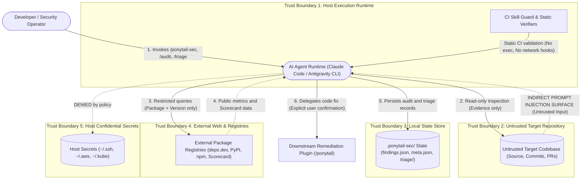

# Threat Model · ponytail-sec

## Document Metadata
- Target System: ponytail-sec
- Version: 0.2.9
- Date: 2026-11-25
- Classification: Public Security Architecture
- Authors: Security Engineering Team
- Status: Production-Grade Disciplined Threat Model
- Frameworks: STRIDE, OWASP Top 10 for LLM Applications (2025)

---

## 1. Executive Summary & Scope

ponytail-sec is a security companion, full-project audit engine, and context-aware triage system designed for AI coding agent environments (Claude Code, Antigravity CLI, Cursor AI). The core architectural philosophy is "the smallest change that ruins an attacker's day" - hunting down missing defensive controls, dropped capabilities, and narrowed RBAC verbs rather than generating verbose finding backlogs.

Because ponytail-sec operates within an autonomous or semi-autonomous LLM agent context inspecting untrusted target repositories, it sits directly at the intersection of agentic prompt injection risks, host filesystem access, external API consumption, and downstream remediation risks. This threat model establishes the rigorous boundaries, STRIDE and OWASP LLM 2025 analysis, operational profiles, and residual risks required to maintain enterprise-grade security.

### 1.1 In-Scope Components
- Plugin Manifests: `.claude-plugin/plugin.json`, `.claude-plugin/marketplace.json`
- Skills Surface:
  - `skills/ponytail-sec/SKILL.md` (companion diff scanner)
  - `skills/ponytail-sec-audit/SKILL.md` (full-repo 3-pass scanner and persistence manager)
  - `skills/ponytail-sec-triage/SKILL.md` (formal finding verification and report builder)
  - `skills/dockerfile/SKILL.md` (binary Dockerfile hardening gate)
  - `skills/k8s-securitycontext/SKILL.md` (binary Kubernetes container security gate)
- Commands Surface: `commands/ponytail-sec.toml`, `commands/ponytail-sec-audit.toml`, `commands/ponytail-sec-triage.toml`
- Agent Personas: `agents/ponytail-sec-triage.md` (isolated, read-only analytical subagent)
- Deterministic Helper Scripts:
  - `skills/ponytail-sec-audit/scripts/previous-scan.sh`
  - `skills/ponytail-sec-triage/scripts/find-scan.sh`
  - `skills/ponytail-sec-triage/scripts/list-findings.sh`
  - `skills/ponytail-sec-triage/scripts/check-triage.sh`
  - `skills/ponytail-sec-triage/scripts/build-index.sh`
  - `skills/ponytail-sec-triage/scripts/shell-summary.sh`
- CI Security Enforcement: `.github/scripts/skill-guard.py`, `.github/scripts/skill-guard-allow.txt`, `.github/workflows/skill-guard.yml`
- Local Audit Persistence Store: `.ponytail-sec/audit-*/` and `.ponytail-sec/triage-*/` directories holding `findings.json`, `meta.json`, and triage reports

### 1.2 Non-Goals
- NG-1: Automated Code Remediation / Modification. ponytail-sec explicitly fixes nothing and never edits audited source code. Remediation delegation is handed to the external plugin `ponytail` or prose instructions for user execution.
- NG-2: Third-Party CVE Vulnerability Enumeration. Auditing and listing off-the-shelf CVEs in consumed dependencies is intentionally out of scope. Pass 2 focuses exclusively on supply chain health, unneeded abstractions, maintainer metrics, and call-site misuses.
- NG-3: Live Dynamic Application Security Testing (DAST) / Cluster Exploitation. ponytail-sec does not execute active penetration testing against running staging or production clusters.
- NG-4: Model Weights and LLM Base Training Security. Attacks targeting underlying LLM foundation weights (e.g., pre-training backdoor insertions at the model provider level) are outside the plugin's operational scope.

---

## 2. Architecture & Trust Boundaries

### 2.1 Trust Boundaries
- **TB-1 (Host Runtime to Untrusted Target Codebase)**: The boundary between the execution runtime (Claude Code / Antigravity CLI process) and the audited repository files on disk. The target repository may contain malicious adversarial comments, poisoned markdown, symlink traps, or malicious filenames designed to hijack the agent. Internal trust: High; External trust: Zero.
- **TB-2 (Agent Core to External Web and Package Registries)**: The outbound network channel used during Pass 2 (Dependency Assessment) and Step 0 triage context intake. Reaches public registries (PyPI, npm, crates.io, pkg.go.dev, Maven Central), deps.dev, OpenSSF Scorecard APIs, and GitHub security advisory endpoints. Internal trust: High; External trust: Low / Public Untrusted.
- **TB-3 (Agent Runtime to Local Persistent State `.ponytail-sec/`)**: The filesystem directory storing audit runs, `findings.json`, `meta.json`, and triage reports. State persisted here is inherited across future git commits and scans. Untrusted code must not be allowed to manipulate or poison this directory via symlinks or unvalidated writes. Internal trust: High; External trust: Medium.
- **TB-4 (Agent Runtime to Host OS and Developer Secrets)**: The boundary safeguarding developer credentials and system files (`~/.ssh`, `~/.aws`, `~/.kube`, `~/.config/gcloud`, uncommitted `.env` files) against ingestion or extraction during repository-wide Grep or Glob searches. Internal trust: Strictly Confidential; External trust: High.
- **TB-5 (ponytail-sec to Downstream Fix Plugin `ponytail`)**: The demarcation between ponytail-sec (which is strictly read-only, has no hooks, and runs no background processes) and the separate third-party plugin `ponytail` (which installs hooks on every agent turn and edits files). Internal trust: High; External trust: External Third-Party (`DietrichGebert/ponytail`).

### 2.2 Data Flow Diagram


---

## 3. Data Classification & Asset Inventory

| Asset ID | Asset Name | Classification | Integrity Impact | Confidentiality Impact | Availability Impact | Handling Rules |
|---|---|---|---|---|---|---|
| **ASSET-1** | Developer Host Credentials (`~/.ssh`, `~/.aws`, `~/.kube`, Cloud Tokens) | Strictly Confidential | High | Critical | Low | Must never be read, indexed, or transmitted. Explicitly blocked by runtime deny rules. |
| **ASSET-2** | Audited Proprietary Source Code | Confidential | High | High | Medium | Read-only access. Excluded from outbound network queries. Sanitized before triage subagent bundling. |
| **ASSET-3** | Target Repository Secrets (`.env`, private keys, API tokens) | Confidential | Low | High | Low | Reported strictly by location, type, and at most the last 4 characters. Full values forbidden from console output, reports, and JSON databases. |
| **ASSET-4** | Persistent Finding Store (`.ponytail-sec/findings.json`, `meta.json`, triage reports) | Internal / Confidential | Critical | High | Medium | Confined to repo root `.ponytail-sec/`. Symlinks strictly rejected. `findings_sha256` checked. CODEOWNERS protection required. |
| **ASSET-5** | Plugin Codebase and Prompts (`SKILL.md`, `commands/*.toml`, `scripts/*.sh`) | Public / Integrity Critical | Critical | None | High | Strictly verified by CI `skill-guard.py`, Git SHA commit pinning, and OpenSSF Scorecard auditing. |

---

## 4. STRIDE Threat Analysis Matrix

| Threat ID | STRIDE Category | Threat Description | Affected Component | Risk Level | Mitigation Controls | Verification Tests |
|---|---|---|---|---|---|---|
| **THREAT-01** | Tampering, Elevation of Privilege | Indirect prompt injection embedded in repo files attempting to force shell execution or silence findings. | All Skills, Triage Subagent | Critical | Invariant treating repo content as evidence, never instructions; CI forbids non-read-only tools in allowed-tools; runtime confirmation for shell. | `tests/skill-guard-test.sh`, injection test suites |
| **THREAT-02** | Information Disclosure | Sensitive source code, credentials, or internal IPs exfiltrated via Pass 2 search/fetch queries. | Pass 2, Triage Web Queries | High | Prompt invariant restricts outbound queries to package name + version + generic terms; domain allowlisting in `.claude/settings.json`; secret truncation. | Static review of prompts, egress traffic proxying |
| **THREAT-03** | Tampering, Elevation of Privilege | Supply chain compromise of ponytail-sec repository, malicious tags, or hidden Unicode backdoors. | CI Workflows, Plugin Distribution | High | `.github/scripts/skill-guard.py` checks bidi/invisible Unicode, exec syntax, symlinks; pinned actions; zizmor workflow analysis. | `skill-guard-test.sh`, zizmor scan in CI |
| **THREAT-04** | Tampering, Spoofing | Local state poisoning: forged `.ponytail-sec/` state injected via PR to suppress valid vulnerability findings. | `previous-scan.sh`, `find-scan.sh`, `check-triage.sh` | High | Strict path confinement rejecting symlinks; commit ancestry verification (`git merge-base --is-ancestor`); SHA-256 verification of `findings.json`; stale state invalidation on git diff. | `tests/scripts-test.sh` state tampering cases |
| **THREAT-05** | Tampering, Elevation of Privilege | Flawed or malicious code remediations generated downstream and applied without review. | Downstream handoff to `/ponytail` | Medium | ponytail-sec is strictly read-only and never modifies code; mandatory Break-Risk rating (Low/Medium/High) on all findings; opt-in manual handoff. | Check that no skill declares Edit/Write tools; schema validation |
| **THREAT-06** | Elevation of Privilege | Excessive agency: agent reasoning loop executing destructive shell commands under guise of triage. | Triage Subagent, Main Agent | Critical | Zero install-time hooks; triage subagent restricted strictly to Read, Grep, Glob (no Bash); human confirmation required for evidence shell commands. | `skill-guard.py` agent tool check; runtime execution gates |
| **THREAT-07** | Information Disclosure | System prompt or skill instruction extraction via prompt leakage. | SKILL.md files | Informational | System is 100% open-source under MIT; security relies on verifiable controls, not obscurity. | Not applicable (open source) |
| **THREAT-08** | Tampering, Information Disclosure | Vector database poisoning or embedding retrieval cross-tenant leaks. | Core Architecture | None | ponytail-sec contains zero vector stores, embeddings, or RAG infrastructure; all context intake is deterministic. | Codebase inspection confirming no vector dependencies |
| **THREAT-09** | Repudiation | Hallucinated vulnerabilities, fabricated CVEs, or mathematically invalid CVSS 4.0 vectors. | Audit Scoring, Triage Validation | Medium | Segregation of Vulnerability (CVSS 4.0 base vector) vs Hardening (categorical efficacy); deterministic frontmatter validation via `check-triage.sh`; anti-hallucination prompt boundaries. | `check-triage.sh` frontmatter verification tests |
| **THREAT-10** | Denial of Service | Algorithmic DoS / token exhaustion via massive binary blobs, circular directory loops, or runaway loops. | File Readers, Helper Scripts | Medium | Strict cap of at most 3 material findings in companion mode; binary file exclusions; `find -mindepth 1 -maxdepth 1` with NUL delimiter in helper scripts. | `tests/scripts-test.sh` empty/large directory test cases |

---

## 5. OWASP Top 10 for LLM Applications (2025) Risk Mapping

| OWASP LLM ID | Risk Title | Applicability & Threat Vector | Defensive Control in ponytail-sec |
|---|---|---|---|
| **LLM01:2025** | Prompt Injection | High: Adversarial repository code or PR comments attempting to steer agent behavior. | Universal evidence-only invariant; CI blocks non-read-only tool pre-approval; execution sandbox. |
| **LLM02:2025** | Sensitive Information Disclosure | High: Proprietary repo data or credentials leaked in Pass 2 web queries or triage reports. | Strict query sanitization (package name + version only); secret truncation (last 4 chars max); denied host credential paths. |
| **LLM03:2025** | Supply Chain | High: Compromised plugin dependencies or malicious skill modification. | Python CI skill-guard scanning all commits; pinned action commit SHAs; OpenSSF Scorecard; no third-party package dependencies. |
| **LLM04:2025** | Data and Model Poisoning | High: Manipulated persistent audit state (`.ponytail-sec/`) poisoning future scans. | Cryptographic hash check (`findings_sha256`); git commit ancestry validation; change detection via `git diff`; anti-symlink traversal checks. |
| **LLM05:2025** | Improper Output Handling | Medium: Applying unsafe suggested remediation diffs without runtime verification. | Zero code modification posture; mandatory Break-Risk categorization; explicit runtime testing warnings before applying fixes. |
| **LLM06:2025** | Excessive Agency | Critical: Uncontrolled shell execution or autonomous git pushes during triage. | Zero install-time hooks; triage subagent strictly isolated to Read/Grep/Glob; interactive human confirmation required for Bash. |
| **LLM07:2025** | System Prompt Leakage | Informational: Prompt extraction. | Accepted by design; all prompts and skills are public open-source MIT files. |
| **LLM08:2025** | Vector and Embedding Weaknesses | None: Embedding tampering. | Zero vector/embedding infrastructure utilized. |
| **LLM09:2025** | Misinformation | High: Hallucinated CVEs, invalid CVSS vectors, and skewed risk ratings. | Segregated Vulnerability vs Hardening models; jq schema enforcement in `check-triage.sh`; prohibition of third-party CVE scraping. |
| **LLM10:2025** | Unbounded Consumption | Medium: Runaway token consumption, gigabyte file reads, or circular symlink loops. | Companion mode capped at 3 material findings; max-depth directory traversal; binary file filters; optional offline cost tracking. |

---

## 6. Safe Operating Profiles

### 6.1 Profile A: Claude Code Hardened Profile
Configure in `.claude/settings.json` within the target repository:
```json
{
  "permissions": {
    "ask": [
      "Read(**/.env)",
      "Read(**/.env.*)",
      "Read(**/*.pem)",
      "Read(**/*.key)"
    ],
    "deny": [
      "Read(~/.ssh/**)",
      "Read(~/.aws/**)",
      "Read(~/.config/gcloud/**)",
      "Read(~/.kube/config)"
    ],
    "allow": [
      "Edit(/.ponytail-sec/**)",
      "WebFetch(domain:pypi.org)",
      "WebFetch(domain:www.npmjs.com)",
      "WebFetch(domain:registry.npmjs.org)",
      "WebFetch(domain:pkg.go.dev)",
      "WebFetch(domain:crates.io)",
      "WebFetch(domain:central.sonatype.com)",
      "WebFetch(domain:rubygems.org)",
      "WebFetch(domain:deps.dev)",
      "WebFetch(domain:api.deps.dev)",
      "WebFetch(domain:scorecard.dev)",
      "WebFetch(domain:api.securityscorecards.dev)",
      "WebFetch(domain:github.com)",
      "WebFetch(domain:raw.githubusercontent.com)"
    ]
  },
  "sandbox": {
    "enabled": true
  }
}
```

Rules:
1. Filesystem writes outside of `/.ponytail-sec/**` require explicit interactive approval.
2. Bash tool execution must NEVER be configured to "always allow" when auditing untrusted code.
3. Auto-execution mode and `bypassPermissions` must remain disabled during untrusted pull request reviews.
4. The Linux bubblewrap sandbox restricts unapproved socket operations and write access.

### 6.2 Profile B: Antigravity CLI Isolation Profile
Recommended containment when executing audits in headless or CI runner environments:
- **Container Enclosure**: Run inside an ephemeral container (Docker/Podman) with all host mounts mounted strictly read-only (`ro`), except for a tmpfs or volume allocated specifically for `.ponytail-sec/`.
- **Runtime User**: Non-root execution (UID 10001, GID 10001) with `allowPrivilegeEscalation=false` and `capabilities: { drop: ["ALL"] }`.
- **Environment Sanitization**: Strip developer credentials (`SSH_AUTH_SOCK`, `AWS_SECRET_ACCESS_KEY`, `GITHUB_TOKEN`, `KUBECONFIG`) from the process environment.
- **Egress Network Policy**: DNS and egress filtering restricting outbound TCP 443 exclusively to approved package registry hostnames.

### 6.3 Profile C: Headless CI / PR Automated Scanner Profile
- Runner permissions: `contents: read` only.
- Standalone execution mode without interactive triage subagents.
- Artifact preservation: Persist `.ponytail-sec/` with SHA-256 integrity checksum logs.
- Failure criteria: Pipeline fails (exit 1) on unvalidated state tampering or broken schema.

---

## 7. Verification & Regression Testing

The integrity of these security controls is enforced deterministically by automated test harnesses:
- **CI Skill Guard (`.github/scripts/skill-guard.py`)**: Runs on every pull request and push. Verifies prompt surface, blocks non-read-only tool pre-approvals, detects backtick shell execution patterns, rejects symlinks and submodules, and scans for bidirectional or invisible Unicode categories.
- **Skill Guard Test Suite (`tests/skill-guard-test.sh`)**: 26 automated regression test cases validating detection of hidden attack vectors.
- **Scripts Test Suite (`tests/scripts-test.sh`)**: 222 automated regression test cases validating path confinement, ancestry checks, hash validation, frontmatter schemas, and anti-symlink defenses across all helper scripts.

---

## 8. Residual Risk Acceptance Register

| Risk ID | Residual Risk Description | Inherent Risk | Residual Risk | Compensating Controls | Acceptance Rationale |
|---|---|---|---|---|---|
| **RR-01** | Indirect Prompt Injection Cognitive Bias | Critical | Low-to-Medium | Hard tool permissions outside the model (read-only allowed-tools, CI guard rejection of Bash pre-approval, human confirmation, bubblewrap sandbox). | Fundamental property of running LLMs on arbitrary text. Mitigated through deterministic host-level confinement. |
| **RR-02** | Sensitive Exploit PoC Storage in Triage Reports | High | Medium | Skills instruct never to commit open vulnerability reports; secrets truncated to last 4 characters; CODEOWNERS on `.ponytail-sec/`. | Necessary operational artifact for security triage; managed via `.gitignore` or private security advisories. |
| **RR-03** | Public Web Search Query Privacy | Medium | Low | Prompt invariant restricts queries to package name + version + generic terms; zero repository source code or secrets permitted outbound. | Essential for assessing public supply chain risk; mitigated by strict input sanitization. |
| **RR-04** | Break-Risk in Aggressive Hardening Recommendations | Medium | Low | Mandatory Break-Risk rating on all findings; explicit warning requiring runtime validation; ponytail-sec never applies changes autonomously. | Inherent trade-off of least-privilege security analysis; safe by design because changes require human review. |
| **RR-05** | Pre-Existing Well-Formed Planted State | Medium | Low | CODEOWNERS protection required for `.ponytail-sec/`; `findings_sha256` checked against `meta.json`; fresh audit triggered on code diffs. | An adversary with commit access already controls the repository; state inheritance follows the repository trust boundary. |

---

## 9. Conclusion

ponytail-sec delivers enterprise-grade security analysis by enforcing defense-in-depth across the entire agent lifecycle:
1. Complete absence of install-time hooks, MCP servers, or background daemon execution.
2. Deterministic CI enforcement (`skill-guard.py`) rejecting non-read-only tool pre-approvals, hidden Unicode, and exec syntax.
3. Strict anti-tampering and anti-symlink confinement across all persistence scripts (`find-scan.sh`, `previous-scan.sh`, `check-triage.sh`).
4. Subagent isolation restricting the triage agent to Read, Grep, and Glob while withholding narrative context to prevent biased or injected verdicts.
5. Explicit delegation boundary separating ponytail-sec from external write plugins like ponytail.
